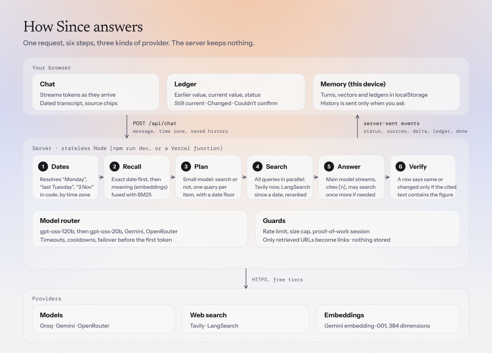
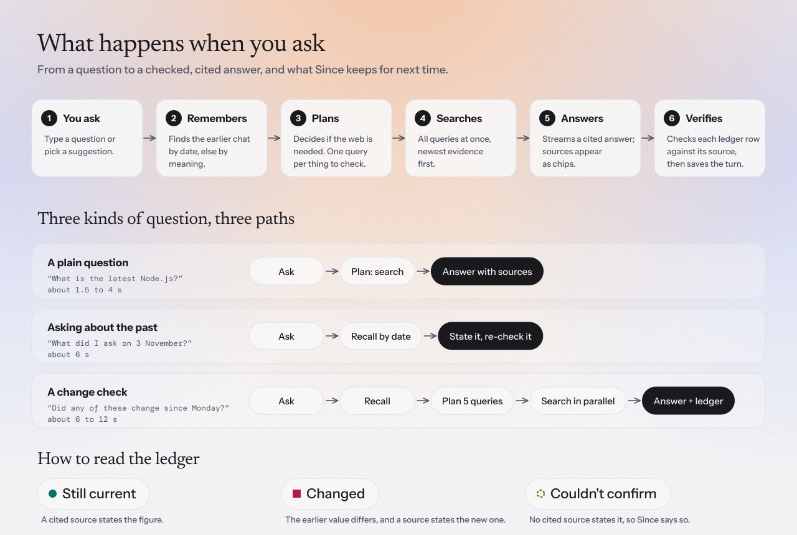

# Design

**Since** is a chat agent with exactly one tool, web search. The hard part of the target questions ("has any of these changed *since Monday*?", "is the answer I gave on 3 November *still right*?") is not searching. It is knowing which earlier conversation you mean, asking the web only for what changed after it, and not claiming a confirmation the sources do not contain. The architecture is built around those three things.

<picture>
  <source media="(prefers-color-scheme: dark)" srcset="docs/assets/architecture-dark.svg">
  
</picture>

## How it works

One message goes through six steps. Only steps 3 and 5 call a language model.

1. **Dates, in code.** `dates.js` turns "Monday", "last Tuesday", "3 November" into calendar days in the user's time zone. "Last Tuesday" said on a Wednesday is ambiguous, so both candidates are kept.
2. **Recall, not a tool.** The browser sends its saved history. `memory.js` picks relevant turns: an exact date filter first, otherwise two rankers fused by reciprocal rank, meaning (Gemini embeddings of question plus the start of the answer) and BM25 (stemmed, so *pricing* matches *price*). A relevance bar means an unrelated question recalls nothing. The turns reach the model as dated text, so the model compares dated text instead of trusting similarity to say what is current.
3. **Plan.** A small model (`gpt-oss-20b`, about 0.6 s) decides whether to search and writes one query per item, with a date floor and a word every relevant page must contain.
4. **Search, in parallel.** For "since" questions each query runs two searches: LangSearch with an exact date range (what was published since) and Tavily (the current official page). A vendor's pricing page is not "published" inside a date window, so a window alone returns spam and misses the page with today's price. Results are cut to their most relevant sentences (a price beats a cookie banner), ranked with one batched embedding call for the whole message, capped at one result per domain (two for the vendor's own site), and dropped if they never mention the product.
5. **Answer.** The main model streams from the results and may search once more.
6. **Verify.** `verifyLedger` checks each row. A row may say *same* or *changed* only if the cited source text contains the figure, and the "earlier" value must appear in the earlier answer. Otherwise it is downgraded to *couldn't confirm*. Citations only link to URLs that were actually retrieved.

<picture>
  <source media="(prefers-color-scheme: dark)" srcset="docs/assets/user-flow-dark.svg">
  
</picture>

Typical time on the free tiers: 6 s for a five-product re-check (0.7 plan, 4 search, 0.6 answer), 1.5 s for chit-chat.

## Why it is built this way

- **Stateless server, memory in the browser.** Free hosts wipe their disk, so the server keeps nothing and history travels in the request. Same behaviour on a laptop, Render or Vercel, and API callers can pass history themselves. Cost: memory is per browser, and request size grows (about 1 MB at 300 turns).
- **Harness-driven fan-out.** I first let the model drive a tool loop. `gpt-oss` issued one search per round: 15 s for five products. A planner plus parallel searches cut that to 6 s and removed a class of tool-call failures.
- **Verification over trust.** In testing the model marked prices *same* with no source stating them, and invented its own "earlier" values. Deterministic checks catch what prompting did not.
- **Zero dependencies.** Every provider speaks the OpenAI chat format, so `llm.js` is a table of routes plus one `fetch` client. `npm install` is instant and there is nothing to audit.
- **Failover is a feature.** Groq's free tier is 8,000 tokens a minute per model, each with its own bucket. Routes: `gpt-oss-120b`, `gpt-oss-20b`, Gemini, OpenRouter. A failed route cools down. Failover never happens after text has started streaming. Foreign tool calls are flattened to text on a switch (Gemini rejects them otherwise).
- **Bot protection without a database.** A signed proof-of-work session cookie, off unless `SESSION_SECRET` is set, with an optional invite code. It makes abuse cost CPU per session; it cannot stop a determined attacker.

## Considered and rejected

- **Memory as a second tool**: breaks "one tool" and costs a model round trip.
- **Vector database or local embedding model**: a few hundred turns need a loop, not a database, and a local model meant a native install and a cold-start download. Embeddings only locate old turns.
- **Groq's built-in search, Gemini grounding**: billed or model-side, with no exact date range.
- **LangChain, the AI SDK, multi-agent research**: more moving parts than the problem needs.
- **Letting the model say "unchanged"**: see verification above.
- **A hosted database or accounts for sign-up**: another service and a key for a demo; a signed cookie does the job.

## Known limits

- Free-tier quotas decide capacity. Search is paced because LangSearch returns 429 under bursts.
- Verification proves a figure appears in the cited snippet, not that it is the right plan: one run compared a Starter price with a Growth price.
- Snippets are short to fit Groq's token window, so some real prices show as *couldn't confirm*.
- The bot check is stateless: a solved challenge can be replayed for 90 seconds and per-IP limits live in one server instance.
- Free-tier prompts may be used for training by some providers. Do not paste sensitive data.

## With another week

1. Read the full page for the top hit per claim (fetch and extract) so verification checks the page, not a snippet.
2. Match plans by name before comparing prices, to stop tier mix-ups.
3. An evaluation set from the three example prompts and a scripted "week later" replay, run on every change.
4. Store claims as structured rows (item, value, date, source) so "what changed since" becomes a diff over data, not text.
5. Optional encrypted server-side history for cross-device memory, and a shared store for rate limits.
