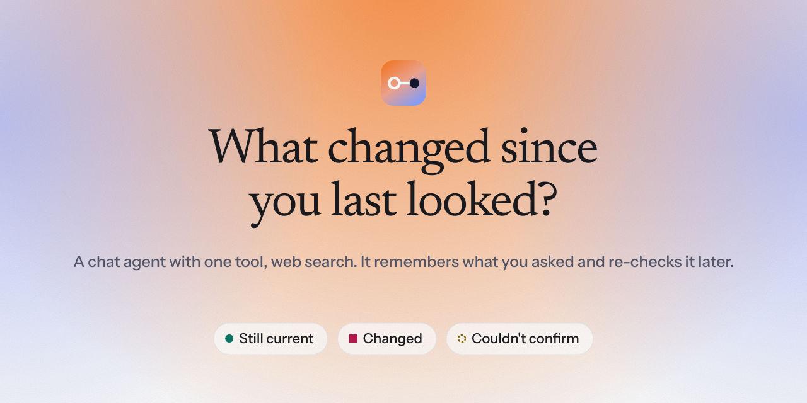
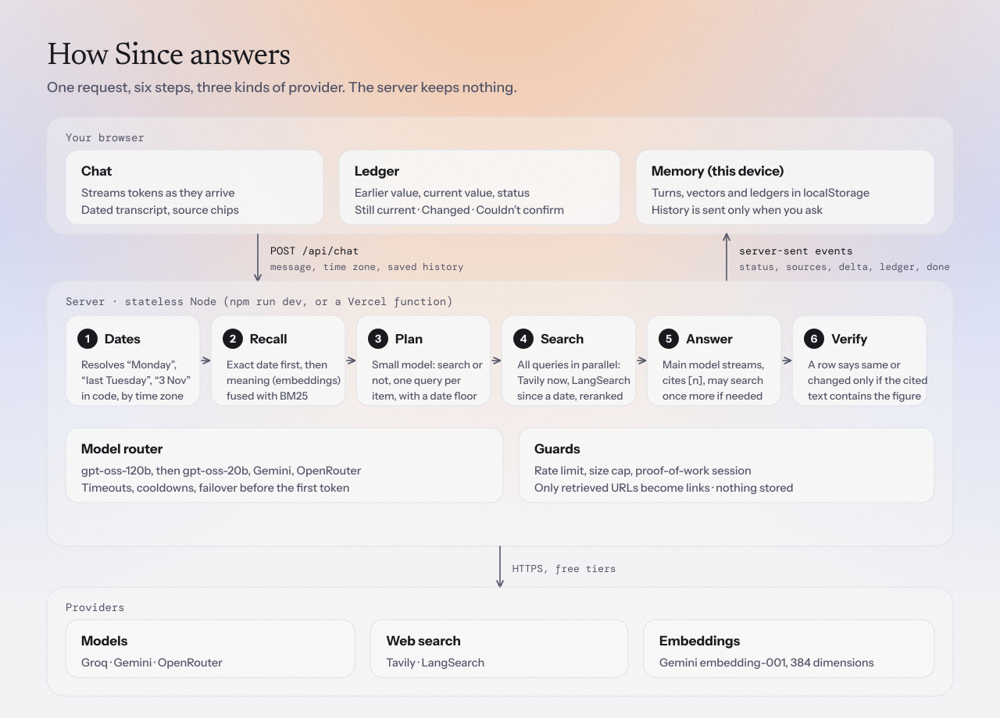
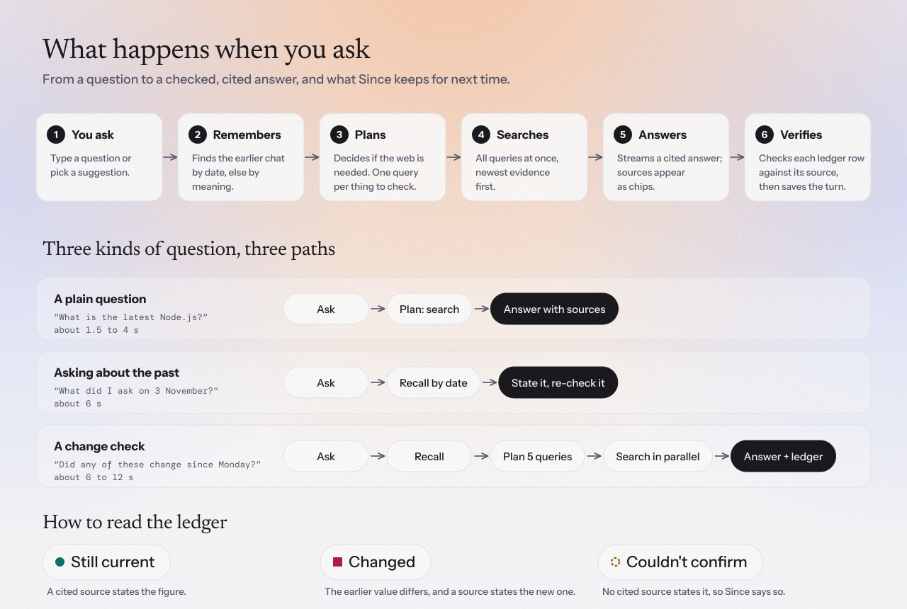

<p align="center">
  <picture>
    <source media="(prefers-color-scheme: dark)" srcset="docs/assets/banner-dark.svg">
    
  </picture>
</p>

<p align="center">
  <a href="https://since-neon.vercel.app"><b>Live demo</b></a> ·
  <a href="DESIGN.md">Design</a> ·
  <a href="docs/ARCHITECTURE.md">Architecture</a> ·
  <a href="docs/USER-FLOW.md">User flow</a> ·
  <a href="docs/BRAND.md">Brand</a>
</p>

<p align="center">
  
  
  
  
</p>

# Since

A chat agent with one tool, web search, built for questions that change over time:

> *"On Monday we shortlisted 5 CRM tools. Has any of them changed pricing or shipped something big since?"*
> *"What did I ask you on 3 November? Is your answer still correct today?"*

Since remembers what you asked, finds that earlier conversation by date or by meaning, re-checks each claim against the live web, and shows the result as a **ledger**: the earlier value, the current value, and a status. A row only says *Still current* or *Changed* if the cited source text actually contains the figure. Otherwise it says *Couldn't confirm*.

## How it works

<picture>
  <source media="(prefers-color-scheme: dark)" srcset="docs/assets/architecture-dark.svg">
  
</picture>

1. **Dates, in code.** "Monday", "last Tuesday", "3 November" become real calendar days in your time zone.
2. **Recall.** Exact date first, otherwise meaning (embeddings) fused with BM25 keyword ranking.
3. **Plan.** A small model decides whether to search and writes one query per item to check.
4. **Search, in parallel.** Tavily for what is true now, LangSearch for what was published since a date. One batched ranking call, relevant sentences instead of page openings, one result per domain.
5. **Answer.** The main model streams a cited answer.
6. **Verify.** Each ledger row is checked against the text of the source it cites, and the earlier value is checked against your earlier answer.

The server keeps nothing. Your history lives in your browser and travels with each request.

## What you see

<picture>
  <source media="(prefers-color-scheme: dark)" srcset="docs/assets/user-flow-dark.svg">
  
</picture>

## Run it

```sh
npm install            # no dependencies, finishes instantly
cp .env.example .env   # then add your keys
npm run dev            # http://localhost:3000
```

Node 22 or newer. `npm test` runs 39 unit tests with no network and no keys.

### Keys

All free tiers. Names only are in `.env.example`; `.env` is git-ignored.

| Key | Used for |
|---|---|
| `GROQ_API_KEY` | Main model (`gpt-oss-120b`, with `gpt-oss-20b` as a second route) |
| `LANGSEARCH_API_KEY` | Search with exact date ranges |
| `GEMINI_API_KEY` | Embeddings (semantic recall, ranking) and the second model |
| `TAVILY_API_KEY` | Optional. Current official pages, and a fallback for LangSearch |
| `OPENROUTER_API_KEY` | Optional. Third model fallback |
| `SESSION_SECRET` | Optional. Turns on the bot check for a public deployment (see below) |
| `ACCESS_CODE` | Optional. Makes the bot-checked deployment invite-only |

## Try the three example questions

Open the app, choose **Load sample history** (Settings, or the link on the empty screen), then ask:

1. *On Monday we shortlisted 5 CRM tools for a 20-person sales team. Has any of them changed pricing or shipped something big since?*
2. *What did I ask you on 3 November? Is your answer still correct today?*
3. *Last Tuesday I asked you about Postgres hosting. Has any pricing changed since then?*

The sample history is dated relative to today, so these phrases always resolve. "Last Tuesday" is ambiguous on most days, so Since keeps both candidate days and lets the dates in the recalled turns decide.

## Settings

Open **Settings** in the sidebar: theme (system, light, dark), answer style (concise or detailed), search depth (fast, balanced, thorough), whether to use saved history, time zone, and export or clear your memory. Shortcuts: `⌘K` new chat, `/` focus the message box, `Esc` stop.

## API

```sh
curl -s localhost:3000/api/chat -H 'content-type: application/json' -H 'accept: application/json' \
  -d '{"message":"Compare Neon and Supabase pricing","tz":"Europe/London","searchDepth":"balanced"}'
```

Returns `{ answer, sources, meta }`. Send `accept: text/event-stream` for streaming events: `status`, `sources`, `delta`, `ledger`, `done`, `vectors`, `error`. To give the agent memory over the API, pass `memory: [{ id, ts, q, a }]` and `recent: [{ id, q, a }]` in the body. `GET /api/health` lists which providers are configured (names only).

## Bot protection

For a public deployment, set `SESSION_SECRET` (any random string of 16+ characters). The first message then triggers a small proof-of-work puzzle in the browser (about a second of CPU) that earns a signed 24-hour session cookie, and `/api/chat` refuses requests without one. Add `ACCESS_CODE` to make the demo invite-only. With no `SESSION_SECRET` (local runs) nothing is gated. It is stateless, so it raises the cost of abuse rather than making it impossible; see [ARCHITECTURE](docs/ARCHITECTURE.md#bot-protection).

## Deploy (Vercel)

`api/*.js` re-export the same handlers the local server uses, `public/` is served as static files, and `vercel.json` sets the function timeout and security headers. Add the keys as environment variables, then `npx vercel deploy --prod`. No database is needed.

## Layout

```
server/  dates.js     "last Tuesday" to calendar days, in code
         memory.js    recall: exact date, else BM25 + embeddings fused
         search.js    the one tool: Tavily + LangSearch, extract, rank, cap
         llm.js       one streaming client, failover across models
         agent.js     plan, parallel search, answer, verify
         session.js   proof-of-work session (off unless SESSION_SECRET is set)
         index.js     HTTP and server-sent events
public/  the app: plain ES modules, no build step
api/     Vercel entry points
docs/    architecture, user flow, brand, and the images in this README
scripts/ build-assets.mjs regenerates the banner and diagrams
tests/   dates, recall, search, ledger verification, citations, sessions
```

## Honest limits

Free tiers set the capacity (Groq allows 8,000 tokens a minute per model). Verification proves a figure appears in the cited snippet, not that it belongs to the right plan. Snippets are short, so some real prices show as *Couldn't confirm*. Some free providers may train on prompts, so do not paste anything sensitive. [DESIGN.md](DESIGN.md) has the full list and what I would do with another week.
