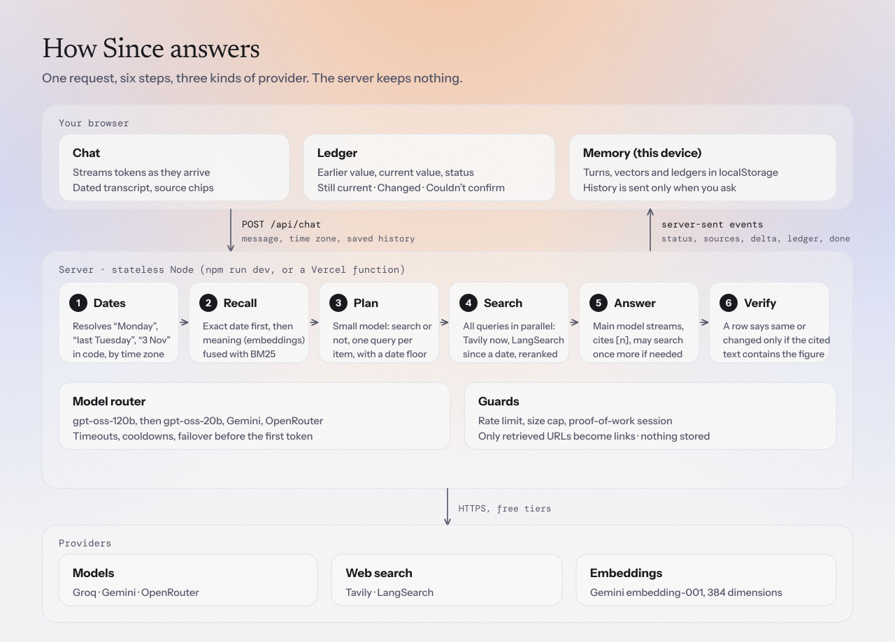
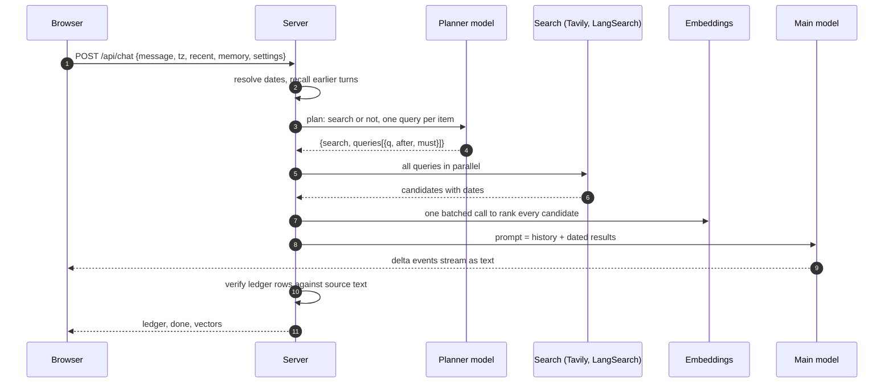

# Architecture

<picture>
  <source media="(prefers-color-scheme: dark)" srcset="assets/architecture-dark.svg">
  
</picture>

Since is two things: a **browser app** that holds the conversation and its memory, and a **stateless Node server** that turns one message plus the history the browser chooses to send into a streamed, verified answer. Nothing is stored server-side. The same handlers run as `npm run dev` locally and as Vercel functions in production.

## Components

| Module | Job | Notes |
|---|---|---|
| `server/dates.js` | Resolve "Monday", "last Tuesday", "3 November", "two weeks ago" to calendar days in the user's time zone | Pure functions. "Last Tuesday" keeps two candidate days when ambiguous. |
| `server/memory.js` | Choose which earlier turns to show the model | Exact date first. Otherwise BM25 and embedding similarity fused by reciprocal rank, behind a relevance bar. |
| `server/embed.js` | Gemini embeddings (384 dimensions), stemming, BM25 | Falls back to keywords if embeddings fail. |
| `server/search.js` | The one tool: `web_search` | Tavily for now, LangSearch for "since a date", sentence extraction, one batched ranking call, per-domain cap, 10-minute cache, in-flight de-duplication. |
| `server/llm.js` | One streaming client for every model | Route table, first-byte and stall timeouts, cooldowns, empty-reply retry, tool-call flattening on failover. |
| `server/agent.js` | The pipeline | Plan, parallel search, answer, verify. Emits server-sent events. |
| `server/session.js` | Bot protection | Signed proof-of-work session. Off unless `SESSION_SECRET` is set. |
| `server/index.js` | HTTP | Static files, `POST /api/chat`, `GET/POST /api/session`, `GET /api/health`, rate limit, security headers. |
| `public/*` | The app | Plain ES modules. `store.js` (memory), `settings.js`, `md.js` (safe Markdown), `gate.js` (bot check), `app.js`. |

## One request, in order



Vectors are sent after `done` so they never delay the answer. The browser stores them with the turn for the next recall.

## Data

A saved turn in the browser (`localStorage`, key `since.v1`):

```json
{ "id": "…", "ts": "2026-11-09T05:00:00.000Z", "q": "…", "a": "…",
  "vec": [384 numbers], "sources": [{ "n": 1, "title": "…", "url": "…", "domain": "…", "date": "2026-11-05" }],
  "ledger": [{ "item": "…", "then": "…", "now": "…", "status": "same|changed|unverified", "src": 2, "reason": "…" }],
  "meta": { "ms": 6300, "searches": 5, "sources": 17, "provider": { "id": "groq", "model": "openai/gpt-oss-120b" } } }
```

Settings live under `since.settings.v1`: `theme`, `answerStyle`, `searchDepth`, `useMemory`, `timezone`. The server validates `searchDepth` and `answerStyle` against a whitelist.

## Failure handling

| What fails | What happens |
|---|---|
| Groq rate limit (8,000 tokens a minute per model) | Falls to the other Groq model, then Gemini, then OpenRouter. The failed route cools down for a minute. |
| A model hangs | 9 s first-byte and 15 s stall timeouts abort it and fail over. |
| A model prints a tool call as text, or returns nothing | Caught before it streams. One retry on the same route for an empty reply, then fail over. |
| Embeddings unavailable | Recall and ranking fall back to keywords. The app still answers. |
| One search provider fails | The other answers for that query. |
| Planner fails or times out (6 s) | The answering model searches for itself with the tool, up to two rounds. |
| Stream breaks after text started | The error is shown. It never switches models mid-sentence. |

## Security

- Secrets come only from environment variables. `.env` is git-ignored and `.env.example` lists names only.
- The model's output is rendered by a small escaping Markdown renderer. Links and citations only resolve to URLs that were actually retrieved.
- Strict `Content-Security-Policy`: scripts only from the site, no inline script.
- Request body capped at 3 MB, per-IP rate limit, static server blocks path traversal, server source and dotfiles return 404.

## Bot protection

When `SESSION_SECRET` is set, `/api/chat` requires a signed `since_session` cookie (HttpOnly, SameSite=Lax, Secure over https, 24 hours).

1. `GET /api/session` returns a signed challenge (90-second life) and the required difficulty.
2. The browser finds a nonce so that `SHA-256(challenge:nonce)` starts with N zero bits (17 by default, roughly a second in a browser).
3. `POST /api/session` verifies the work, and the access code if `ACCESS_CODE` is set, then sets the cookie.

It needs no database, but it is stateless, so a solved challenge can be replayed within its 90 seconds and per-IP limits live in one server instance. Treat it as a cost on abuse, not a wall. Set `ACCESS_CODE` for an invite-only demo.

## Limits worth knowing

- Capacity is the free tiers: Groq 8,000 tokens a minute per model, Tavily about 1,000 credits a month, Gemini embeddings per-minute quotas.
- Request size grows with saved history (about 1 MB at 300 turns). The browser sends the latest 150 turns.
- Everything is tuned for small token budgets: 400-character snippets, at most 4 results per search, at most 8 searches per message.
