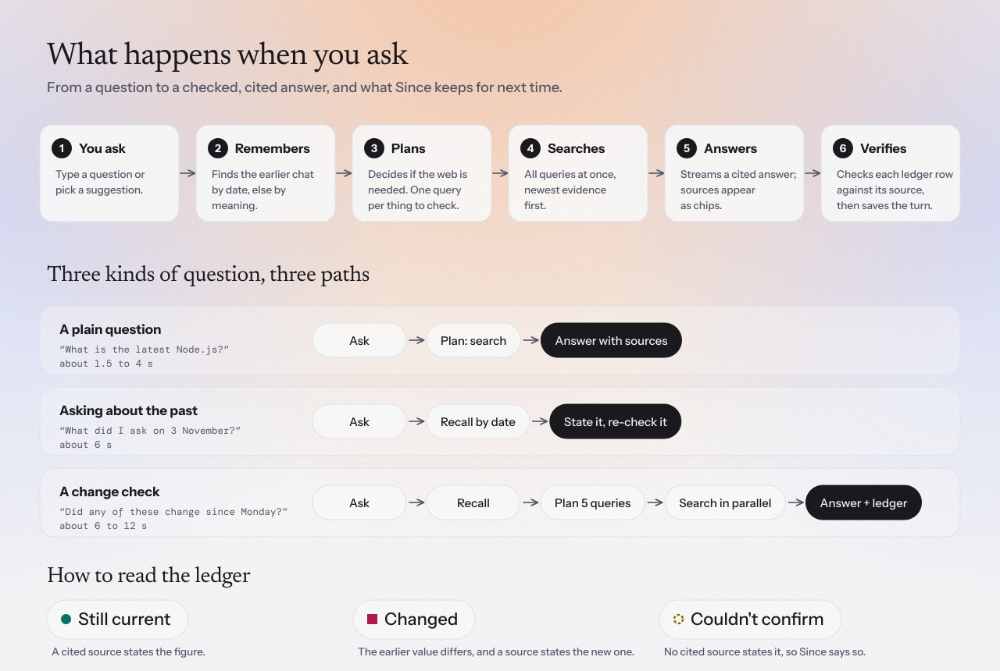

# User flow

<picture>
  <source media="(prefers-color-scheme: dark)" srcset="assets/user-flow-dark.svg">
  
</picture>

## First visit

You land on an empty screen with a warm wash, one headline and four suggestions. Nothing is saved yet. The first suggestion works immediately. The other three refer to earlier chats, so a quiet link offers **Load sample history**, which adds two dated conversations (a CRM shortlist on the last Monday, a Postgres comparison on the Tuesday of last week).

On a public deployment the first message also runs a short invisible check (a puzzle that takes about a second) and, if the site is invite-only, asks for an access code once.

## While an answer is being made

1. Your message appears as a soft bubble on the right.
2. A line shimmers: *Checking your history*, then *Searching the web · 5 queries*. Hover it to see the exact queries.
3. The answer streams in as plain text. Citation chips `[2]` link to the pages that were really retrieved, and the same sources appear as small chips under the answer.
4. If you asked about something from an earlier chat, a **ledger** reveals row by row: the earlier value (struck through if it changed), the current value, and a status.
5. A quiet line shows how long it took, how many searches and sources were used, and which model answered. A copy button sits beside it.

`Esc` or **Stop** cancels at any point. Nothing half-finished is lost: what already streamed is kept.

## Reading the ledger

| Status | Meaning |
|---|---|
| **Still current** | A cited source states the figure, and it matches your earlier answer. |
| **Changed** | The earlier value differs and a cited source states the new one. |
| **Couldn't confirm** | No cited source states it. Since says so instead of guessing. A small reason explains why. |

## Three walk-throughs

**A plain question: "What is the latest Node.js version?"**
Dates: none. Recall: nothing relevant. Plan: one query. Search, answer with sources. About 2 to 4 seconds, no ledger.

**Asking about the past: "What did I ask you on 3 November? Is your answer still correct today?"**
Dates: `3 November` becomes one calendar day. Recall: every turn from that day. The answer starts by stating what you asked and when, then plans one query per claim in that earlier answer, searches since that date, and fills the ledger. About 6 seconds.

**A change check: "On Monday we shortlisted 5 CRM tools. Has any of them changed pricing or shipped something big since?"**
Dates: `Monday` becomes the most recent Monday. Recall: that day's CRM chat. Plan: five queries with `after` set to that Monday. Search: five windowed searches plus five "current page" searches, ranked in one batch. Answer plus a five-row ledger. About 6 to 12 seconds, depending on the free-tier queue.

## Settings

Open **Settings** in the sidebar (gear icon). Theme, answer style (concise or detailed), search depth (fast, balanced, thorough), whether saved history is used, time zone (used to understand "Monday" and "yesterday"), and data controls: export as JSON, load sample history, clear memory. Shortcuts: `⌘K` or `Ctrl+K` new chat, `/` focus the message box, `Esc` stop.
